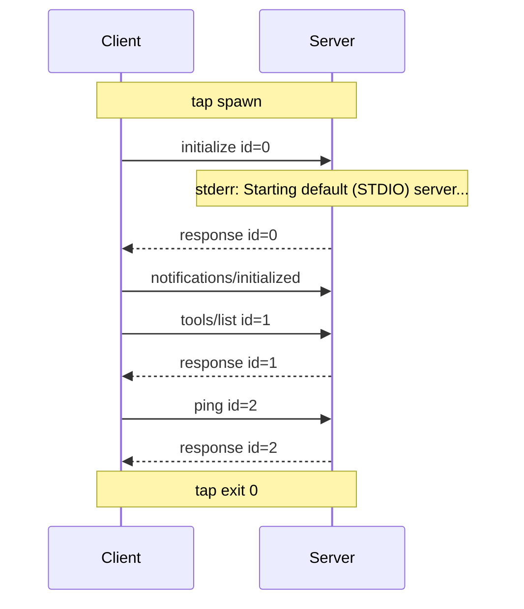

# Lesson 01: the wire and the handshake

## Goal

See what actually crosses a stdio connection between an MCP client and an MCP server, and
understand the 2025-era opening exchange: `initialize`, `notifications/initialized`, then
ordinary requests. You will record a real conversation with a real server, read it
frame by frame, and then break the handshake three ways to learn which of its rules the server
enforces and which are only in the spec.

Setup, once: `scripts/bootstrap.sh` (see the README). Everything below runs from the repo root.

## Predict

Before you run anything, write down on paper or in a scratch file:

1. How many lines does the client send, and how many does the server send back?
2. Which of those lines have an `id`, and which do not? Why?
3. What does the server say in answer to `initialize` that the client did not say in the question?
4. Does anything appear on stderr? Where would it show up if you only watched stdout?

## Run

`scripts/record.sh` feeds a fixture, one line at a time, through the tap into the pinned
everything server and writes the trace into your own `runs/` folder. That folder is
git-ignored: your recordings stay on your machine.

<!-- run -->
```console
$ scripts/record.sh tests/fixtures/handshake-2025.ndjson lesson01
```

<!-- expect -->
```text
recorded: runs/
```

## Read the trace

Print the run as one line per record. Timings differ on every machine; the order and the
arrows do not.

<!-- run -->
```console
$ run=$(ls -d runs/*-lesson01 | tail -1)
$ python3 -m tap.show "$run/trace.jsonl" | grep -o 'request [a-z/]* id=[0-9]'
```

<!-- expect -->
```text
request initialize id=0
request tools/list id=1
request ping id=2
```

The same run as a sequence diagram. This is what `--mermaid` prints for a handshake (yours
will match), and GitHub draws it:



Now read it with explanations. `--explain` prints a note after every frame, taken from
[the walkthrough](../walkthrough/01-handshake-2025.md), and exits non-zero if a frame has no
note:

<!-- run -->
```console
$ run=$(ls -d runs/*-lesson01 | tail -1)
$ python3 -m tap.show "$run/trace.jsonl" --explain docs/walkthrough/01-handshake-2025.md > /dev/null && echo "every frame has a note"
```

<!-- expect -->
```text
every frame has a note
```

Run the same command without the redirect and read every
note against your own prediction. Add `--full` to a plain `tap.show` to see the decoded JSON of
every frame, pretty-printed (the `tools/list` reply runs to hundreds of lines, so pipe it to `less`).

## Read the source

A citation like `servers:path:line "fragment"` points into `vendor/servers/`, and `spec:path:line "fragment"` into `vendor/spec/`; open the file and look at that line.

Two places, both pinned so the line numbers hold. The server hands its stdin and stdout to the
protocol layer here: `servers:src/everything/transports/stdio.ts:49` "serveStdio(". The rule
for what the server must do when the client offers a protocol version is
`spec:docs/specification/2025-11-25/basic/lifecycle.mdx:170` "MUST** respond with the same".
Open both and find, in the walkthrough, which frame each one explains. The server's request
routing lives in the SDK, which this repository does not pin; the walkthrough says where it stops
citing the server.

## Experiments

Each experiment is a fixture in `tests/fixtures/`. Predict, record, read. The outcomes below were
**measured against the pinned server** when this lesson was written; they are what the server did,
not what the spec promises, and the commands here fail if a future pin changes them.

**1. Offer a different `protocolVersion`.** `exp-old-version.ndjson` offers `2024-11-05` (a
version the server supports); `exp-bogus-version.ndjson` offers `1999-01-01` (one nobody
supports). What does the server answer, in each case?

<!-- run -->
```console
$ for f in exp-old-version exp-bogus-version; do
    scripts/record.sh tests/fixtures/$f.ndjson $f > /dev/null
    run=$(ls -d runs/*-$f | tail -1)
    python3 -m tap.show "$run/trace.jsonl" --full |
      awk '/<-  response id=0/ {reply=1} reply && /"protocolVersion"/ {print; reply=0}' |
      grep -o '"protocolVersion": "[^"]*"'
  done
```

<!-- expect -->
```text
"protocolVersion": "2024-11-05"
"protocolVersion": "2025-11-25"
```

Measured: for a version it supports, the server echoes the offer back. For one it does not, it
replies with `2025-11-25`, the newest `initialize`-era version it speaks, and carries on; it does not refuse the connection. Deciding
whether to continue is then the client's job (`spec:docs/specification/2025-11-25/basic/lifecycle.mdx:174` "does not support the version").

**2. Never send `notifications/initialized`.** `exp-no-initialized.ndjson` is the handshake without it.

<!-- run -->
```console
$ scripts/record.sh tests/fixtures/exp-no-initialized.ndjson exp-no-initialized > /dev/null
$ run=$(ls -d runs/*-exp-no-initialized | tail -1)
$ python3 -m tap.show "$run/trace.jsonl" | grep -o 'response id=[0-9]'
```

<!-- expect -->
```text
response id=0
response id=1
response id=2
```

Measured: the server answers `tools/list` and `ping` as if nothing were missing. The spec tells the
client to send the notification (`spec:docs/specification/2025-11-25/basic/lifecycle.mdx:147` "MUST** send an `initialized` notification"),
but this server does not refuse a client that skips it. What it does skip is the work its
`oninitialized` hook does (`servers:src/everything/server/index.ts:194` "server.server.oninitialized").

**3. Send `tools/list` before `initialize`.** `exp-list-first.ndjson` sends the list request first.

<!-- run -->
```console
$ scripts/record.sh tests/fixtures/exp-list-first.ndjson exp-list-first > /dev/null
$ run=$(ls -d runs/*-exp-list-first | tail -1)
$ python3 -m tap.show "$run/trace.jsonl" | grep -o 'response id=[0-9]'
```

<!-- expect -->
```text
response id=1
response id=0
```

Measured: the list request is answered, first, with the full tool list and no error. The spec says a
client should not do this (`spec:docs/specification/2025-11-25/basic/lifecycle.mdx:157` "The client **SHOULD NOT** send requests other than"),
and "should not" is the strength of the rule: this server does not enforce it. Do not build a client that relies on that.

## Check yourself

Answer from your own trace, then open the answers.

1. Which frame is the slowest, and what is its latency spent on?
2. Why are the `ping` and `tools/list` replies both fast (a few milliseconds or less) when `initialize`'s took hundreds?
3. Which line did the server write that was not an MCP message, and where did it go?
4. In experiment 1, who decides what happens after the version mismatch, and what does the spec tell them to do?
5. Which of the three experiments proved the spec's words are stronger than the server's behaviour?

<details>
<summary>Answers</summary>

1. The `initialize` reply: the server is still starting up when the first line reaches it, so the
   latency includes boot time, not only protocol work.
2. Both are small requests to a server that is already running; the cost of starting was paid
   once, before the first reply.
3. The `Starting default (STDIO) server...` line, on stderr, which the tap records as its own stream.
4. The client: the server answers with a version it supports and the client should disconnect if it
   cannot speak that one.
5. Experiments 2 and 3: the rules cited there ("MUST" send `initialized`, "SHOULD NOT" send other
   requests first) bind the client. The spec gives the server no duty to refuse, so this server is
   lenient, and the spec allows that. The lesson is that a client cannot count on the server to
   catch its mistakes.

</details>
